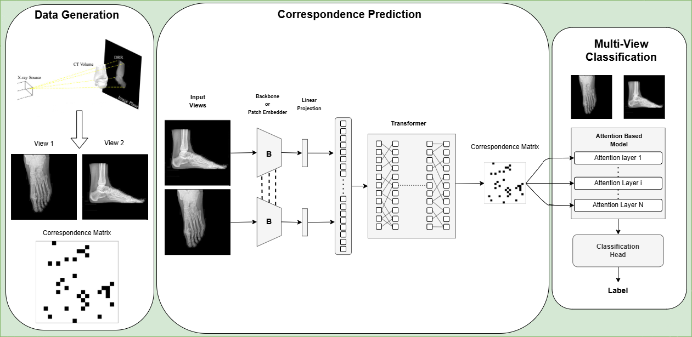
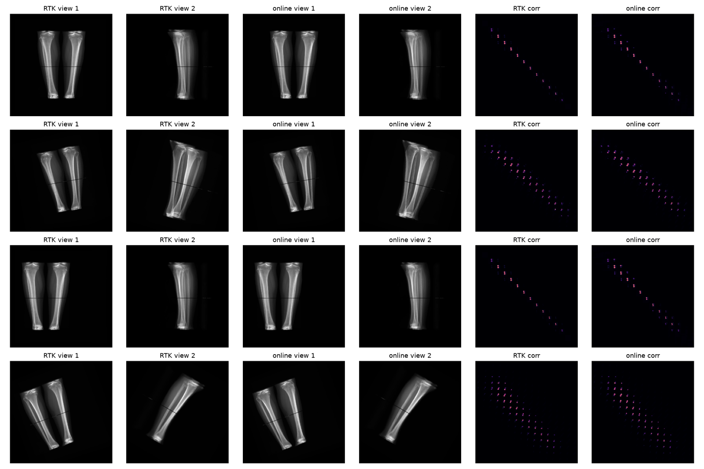

# Multiview Xray Matching

[](#MICCAI)
[![CC BY-NC-SA 4.0][cc-by-nc-sa-shield]][cc-by-nc-sa]
[![CC BY-NC-SA 4.0][cc-by-nc-sa-image]][cc-by-nc-sa]

[cc-by-nc-sa]: http://creativecommons.org/licenses/by-nc-sa/4.0/
[cc-by-nc-sa-image]: https://licensebuttons.net/l/by-nc-sa/4.0/88x31.png
[cc-by-nc-sa-shield]: https://img.shields.io/badge/License-CC%20BY--NC--SA%204.0-lightgrey.svg

<p align="center">
  
</p>

This repository provides the official implementation of our paper:

**“Self-Supervised Multiview Xray Matching”**  
*Mohamad Dabboussi, Malo Huard, Yann Gousseau, Pietro Gori*  
Accepted at **MICCAI 2025**.

---

## 📝 Overview

This project introduces a self-supervised framework to match anatomical correspondences across multiview X-ray images without requiring manual annotations. The method is designed to enhance downstream tasks such as pose estimation and classification by leveraging geometric and appearance-based consistency across views.


## 🔧 Setup

### Environment Setup

Our experiments were tested with the following versions, other versions may also work:
- **Python version** >= 3.9.x
- **PyTorch version**: 2.7.0
```bash
pip install torch==2.6.0 --index-url https://download.pytorch.org/whl/cu124
```
- **PyTorch Lightning version**: 2.2.2
```bash
pip install pytorch-lightning==2.2.2
```

- Install all dependencies via:

```bash
pip install -r requirements.txt
```

## 📁 Data Generation

All CT volumes should be organised in the following structure:

```
Multiview_xray_matching/
├── configs/
├── dataset/
│   └── ct_volumes/
│       ├── volume_1/
│       │   ├── volume_1_1.dcm
│       │   └── volume_1_2.dcm
│       │   └── ....
│       ├── volume_2/
│       └── ...
├── src/
├── ...
```

To generate data, run:

```bash
python src/data/create_csv.py
python src/data/generate_data.py
```

These scripts will:

* Generate the `data.csv` file
* Generate the `data.h5` dataset file

Both output files will be located in the `dataset` folder.


## ⚡ End-to-end mode: on-the-fly DRRs (no dataset on disk)

Instead of generating `data.h5` first, `main_online.py` renders the views **inside the training step**
and derives the correspondence matrix analytically from the camera geometry, so new poses are drawn at
every step and nothing is written to disk. Rendering uses [DiffDRR](https://github.com/eigenvivek/DiffDRR)
(the differentiable renderer behind [xvr](https://github.com/eigenvivek/xvr)) on the GPU.

```bash
pip install -r requirements_online.txt
# (optional, parallel) cache the resampled 256^3 HU cubes once
python scripts/online/prepare_volumes.py --ct_dir dataset/ct_volumes --cache_dir dataset/ct_cache --workers 8
python main_online.py --config configs/config_online.yml
```

* `configs/config_online.yml` — `data.ct_dir` (DICOM series folders and/or `.nii(.gz)`/`.mha`/`.nrrd`), `data.cache_dir`,
  `data.samples_per_epoch`, the pose family (`translate`, new `tilt_std`), renderer settings (`render.n_points`, `render.footprint_samples`)
  and the GPU preprocessing (`preprocess.clahe_clip`). Model/training hyper-parameters are the same as `configs/config.yml`.
* The acquisition distribution is the one of `create_csv.py` (angles, source distances, volume translation); the intensity models
  (`sigmoid(HU + 1000, x0 = 1500)` for the views, `x0 = 850` for the voxel weights), the 16 × 16 patch grid and the max-over-voxels
  definition of the matrix are those of `generate_data.py`.
* **Correspondence ground truth.** For every coarse voxel the footprint on each view is obtained by projecting its sub-points onto the
  detector and counting hits per patch (max-normalised, like the single-voxel Joseph projections of the offline code); the matrix is
  the scatter-max of the outer products weighted by the voxel attenuation — O(voxels) instead of 4,096 ray-casts per pair.
* **Parity with the offline pipeline** (`scripts/online/reference_rtk.py` → `scripts/online/validate_online.py`): on a public knee CT and
  5 acquisitions (AP/lateral, in-plane rolls, translation), the DRRs match RTK's with NCC ≥ 0.9997 and the matrices agree with
  Pearson r 0.96–0.98 / AP 0.95–1.0 (RTK labels at 0.3; `footprint_samples: 4`). In the RTK geometry the second CSV angle is an *in-plane* detector roll
  (gantry fixed at 90°); the identified mapping is `RTK_MAPPING` in `src/data/online_drr.py`, so online images have the orientation of the offline dataset.
* **Speed.** Rendering + ground truth + GPU preprocessing: ≈ 50 pairs/s on a V100S-32GB (batch 16, 256² views, 300 ray samples, 1.7 GiB)
  vs ≈ 30 s per pair for the RTK pipeline on CPU.
* `scripts/online/make_gifs.py` renders the animations/figures of the project page; `scripts/online/benchmark.py` measures throughput.

<p align="center">
  
</p>
<p align="center"><i>Same CT, same acquisitions: RTK views of the offline generator, on-the-fly views, and the two correspondence matrices.</i></p>

## ✨ Correspondence Data Augmentation

The following data augmentation techniques are implemented to improve model robustness.
These augmentations preserve consistency between the views and the correspondence matrix.

* **Geometric Transformations**: random rotations and horizontal flips
* **Masked Crop**: crops a region of the image and masks the rest
* **Cutout**: introduces random black square regions within the image
* **Shift**: applies spatial shifts along x and y axes

All augmentations are configurable within the dataset pipeline.


## 🏋️‍♂️ Correspondence Training and Prediction

Train the correspondence matching model by running:

```bash
python main.py --config configs/config.yml
```

Ensure the config file is set with the correct dataset paths and hyperparameters for your experiments.


## 📊 Visualization

Visualization scripts are provided to inspect data samples, correspondences, and model predictions. Use them to qualitatively assess model performance and dataset characteristics.

## 📄 Citation

If you use this code for your research, please cite our paper.

<!-- ```
@inproceedings{dabboussi2025multiview,
  title={Self-Supervised Multiview Xray Matching},
  author={Dabboussi, Mohamad and Huard, Malo and Gousseau, Yann and Gori, Pietro},
  booktitle={MICCAI},
  year={2025}
}
``` -->


## 🤝 Contact

For questions or collaboration inquiries, please contact us.

---